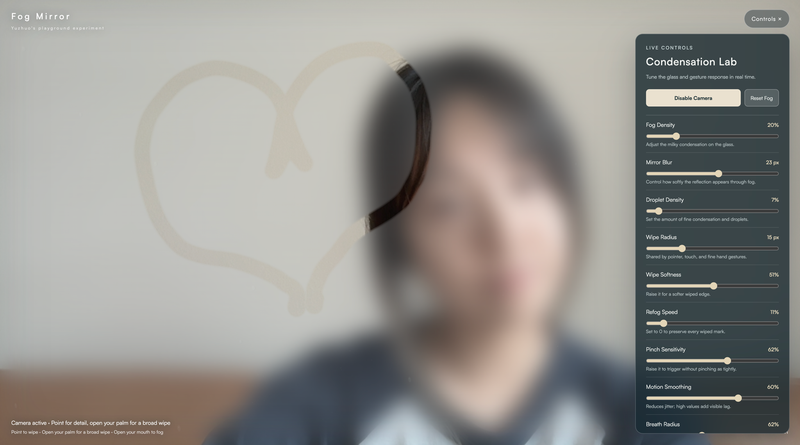

# Fog Mirror

**Yui's playground experiment**

Fog Mirror turns your webcam into a full-screen condensation mirror. Point at the glass to make a precise wipe, open your palm to clear a broad area, or open your mouth to let fog bloom back over the reflection.



The experience lives in one file: [`fog.html`](./fog.html). There is no build step and no microphone access.

## Run it locally

Camera access requires HTTPS or localhost. Opening the file directly with `file://` may prevent the browser from using the webcam.

```bash
python3 -m http.server 8000
```

Then open:

```text
http://localhost:8000/fog.html
```

Chrome or Edge is recommended. Allow camera access when the browser asks. The first launch also needs a network connection so the MediaPipe hand and face models can load from jsDelivr.

## How to use the mirror

| Action | Gesture | Result |
| --- | --- | --- |
| Fine wipe | Extend your index finger and curl the other three fingers | Clears a narrow, controlled path at the fingertip |
| Broad wipe | Open all five fingers | Clears a soft area sized from the visible width of your palm |
| Alternate fine wipe | Pinch your thumb and index finger | Clears a narrow path between the two fingertips |
| Add fog | Open your mouth briefly | Blooms a large, feathered patch of condensation around the mouth |
| Pointer fallback | Drag with a mouse, trackpad, or touch | Clears the fog without a camera |

The open-palm gesture waits for two consecutive detections before it starts wiping. A closed fist does nothing, which helps separate the broad wipe from the single-finger gesture.

The mirror can track up to two hands at once. Each hand keeps its own gesture state and wipe path.

## Live controls

Open **Controls** in the upper-right corner to tune the effect while it is running.

| Control | Default | What it changes |
| --- | ---: | --- |
| Fog Density | 20% | Opacity of the milky condensation layer |
| Mirror Blur | 23 px | Softness of the reflection behind the fog |
| Droplet Density | 7% | Amount of fine condensation texture |
| Wipe Radius | 15 px | Radius used by pointer, touch, pointing, and pinching |
| Wipe Softness | 51% | Feathering around a wiped path |
| Refog Speed | 11% | Rate at which wiped areas gradually fog over again |
| Pinch Sensitivity | 62% | How tightly the thumb and index finger must meet |
| Motion Smoothing | 60% | Balance between stable motion and gesture latency |
| Breath Radius | 62% | Size of a new fog bloom |
| Breath Density | 39% | Visibility of freshly added fog |

Select **Reset Fog** to restore an even layer of condensation.

## Privacy

- Camera frames are processed locally in the browser.
- The page does not request microphone access.
- Open-mouth detection simulates breathing through visual face landmarks.
- No image or gesture data is uploaded by the page.
- MediaPipe assets and the Satoshi webfont are loaded from external CDNs.

## How it works

The mirror is rendered with layered HTML5 canvases:

1. The webcam is drawn as a horizontally mirrored full-screen scene.
2. A blurred reflection, haze, condensation texture, and droplets form the fog layer.
3. A separate mask records wiped regions.
4. MediaPipe Hands classifies pointing, open-palm, and pinching gestures.
5. MediaPipe Face Mesh detects mouth opening and adds soft radial fog blooms.
6. Hand landmarks update target positions while the brush moves and draws on every display frame for smoother motion.

The hand and face models run in a shared serial inference queue. This avoids asking both models to use the browser's inference resources at the same time.

## Design and engineering challenges

### Turning sparse tracking data into a fluid wipe

Hand landmarks do not arrive at the same rhythm as the browser's display frames. Drawing only when a new model result arrived made the wipe feel segmented and jittery. I separated tracking from rendering: MediaPipe updates a target position, while the brush follows that target on every animation frame. Two stages of smoothing and quadratic curves connect the sampled points without making the gesture feel too delayed.

### Distinguishing deliberate gestures from similar hand shapes

Several gestures look surprisingly similar to a landmark model. A pinch can resemble a curled hand, and a raised index finger can briefly appear while the user is opening their palm. I iterated on a small, mutually exclusive gesture vocabulary: an extended index finger creates a fine wipe, five open fingers create a broad wipe, and a closed fist does nothing. The open-palm action requires two consecutive detections, while the pinch uses separate activation and release thresholds to reduce flicker.

### Moving from one hand to two

The first version used MediaPipe's `maxNumHands: 1`, so the model could only return one hand even when both were visible. Changing it to `maxNumHands: 2` exposed a second problem: the brush position, smoothing, gesture debounce, and drawing mode were all stored as one global state. I refactored them into independent tracked-hand states so two hands can wipe at the same time without sharing or jumping between paths.

### Keeping a broad wipe stable after tracking gaps

A large brush makes tracking errors much more visible. If a hand disappeared and reappeared elsewhere, connecting the two positions produced a long accidental streak. The broad wipe is sized from the visible palm, stamped by travel distance rather than frame count, and reset when the tracked position jumps across a large part of the screen.

### Sharing one browser thread between two vision models

The interaction needs hand landmarks for wiping and face landmarks for breathing. Running both models at the same time caused inference contention and intermittent hand-tracking failures. I moved them into a shared serial queue, used the lightweight hand model, and sampled Face Mesh less often than the hand tracker. The display loop remains independent, so the mirror can keep animating between model updates.

### Simulating breath without listening to the user

The fog needed to feel responsive to breathing without requesting microphone access. Face Mesh measures mouth openness and waits for a brief sustained opening before adding a large radial fog bloom. A cooldown prevents repeated triggers, and a feathered gradient gives the new condensation a soft boundary.

### Building condensation from layers

A flat white overlay looked like a screen tint rather than wet glass. The final effect combines a mirrored camera image, a blurred reflection, milky haze, procedural droplets, and a separate wipe mask. The independent mask also makes refogging possible without altering the live video underneath.

## Troubleshooting

### The camera does not start

- Serve the page from localhost or HTTPS.
- Confirm that camera permission is allowed for the site.
- Close other applications that may already be using the camera.

### Hand tracking keeps retrying

- Confirm that jsDelivr is reachable from your network.
- Use a current version of Chrome or Edge.
- Keep one hand clearly visible with steady front lighting.
- Open the browser console and look for `MediaPipe Hands inference failed:` for the underlying error.

### Gestures feel delayed

- Lower **Motion Smoothing** slightly.
- Use even lighting and keep the full hand inside the camera frame.
- A stable camera frame rate is more useful than requesting a high frame rate that the device cannot sustain.

### The broad wipe does not activate

- Show the palm to the camera.
- Separate the thumb from the index finger.
- Keep all five fingers visible for at least two tracking frames.

## Project structure

```text
assets/fog-mirror-demo.png  # README screenshot
fog.html                    # Complete interactive experience
README.md                   # This guide
```

Designed and built by **Yuzhuo Zhang** as a playground experiment.
